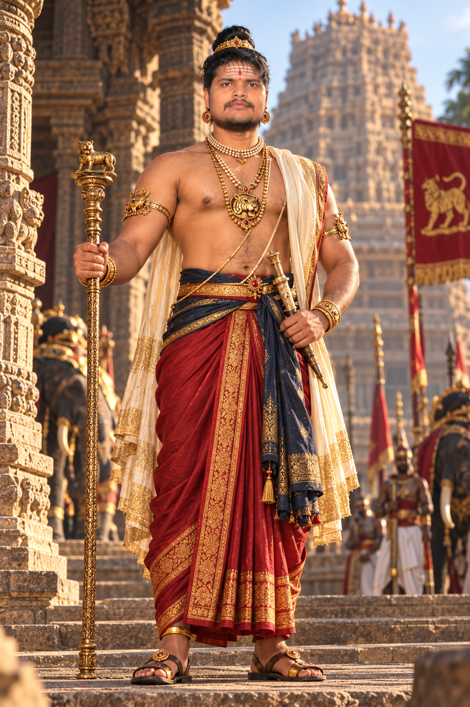

# Character Visual Dossier: Rajendra Chola I (Emperor)

- **Character ID:** CH-01 · **Canonical Tier:** Tier A (Historical)
- **Role:** Chola Emperor / Supreme Sovereign
- **Evidence Tag:** `[HISTORICALLY ATTESTED]` (Built from Thanjavur inscriptions, Chola imperial bronzes, and contemporary dynastic records; stylized sculptural sources per Doc 03 G3)

---

## 1. Physical Anatomy & Visual Identity
- **Age:** 34–38 years old (during early accession and the founding of Gangaikondacholapuram, c. 1014–1025 CE).
- **Height / Build:** 183 cm (6'0"), commanding, athletic, military posture reflecting decades of campaign experience alongside Rajaraja I. Broad shoulders, straight spine, disciplined royal carriage.
- **Skin Tone:** Warm deep bronze/copper with natural sun exposure from southern coastal campaigns.
- **Facial Features:** High cheekbones, strong aquiline nose with subtle regal bridge, defined jawline, dark almond-shaped observant eyes. Composed, unhurried expression.
- **Hair & Beard:** Long, lustrous black hair gathered into a traditional high side-swept royal topknot (*Kudumi*) secured with a thin gold cord (*Karnika*). Well-trimmed, neat mustache contoured along the upper lip, clean-shaven cheeks and jaw per period royal sculptural conventions.
- **Forehead Markings:** Three subtle horizontal lines of sacred grey ash (*Vibhuti*) across the brow with a small vermilion dot (*Tilakam*) at the center.

---

## 2. Costume & Textiles
- **Lower Garment (Veshti / Dhoti):** Fine hand-woven unbleached mulberry silk (*Pattu*) draped in the *Kaccha* style between the legs, reaching mid-calf. Base color is deep madder red / rich terracotta with woven gold zari (*Zari*) geometric borders along the lower hem and front pleated pleats.
- **Sash (Kachhai / Patka):** Broad folded silk waist-sash dyed in indigo-tinted dark navy with embroidered gold terminals tied at the left hip and draping gracefully to the knee.
- **Upper Body:** Bare torso per 11th-century Chola royal temple relief conventions; draped across the left shoulder is a folded royal stole (*Uttariya*) of gossamer ivory muslin edged in saffron-gold thread.
- **Footwear:** Hand-stitched leather royal sandals with gilded toe-pegs and circular gold buckles.

---

## 3. Jewelry & Regalia (Gold as Material Accent, Never Fantasy Wash)
- **Crown / Headband:** Narrow royal coronet (*Makuta* / *Pattam*) of chased 24k gold set with uncut cabochon rubies and natural pearls from the Gulf of Mannar.
- **Ear Ornaments:** Heavy circular gold hoop earrings (*Kundalas*) stretching the earlobes slightly per classic Dravidian sculptural tradition.
- **Necklaces:** 
  1. Multi-strand choker of wild natural seed pearls (*Muthuaram*).
  2. Longer chest pendant necklace (*Kanthahara*) featuring a repoussé gold Tiger medallion (the Chola dynastic crest).
  3. Sacred thread (*Yajnopavita*) in triple-ply gold thread passing across the left chest to right waist.
- **Arms & Wrists:** Solid gold armlets (*Keyuras*) with makara motifs on biceps; twin twisted-gold bracelets (*Kanganas*) on both wrists.

---

## 4. Personal Props & Weapons
- **Imperial Scepter (*Raja-Dhandam*):** Heavy solid chased-gold scepter topped with the crouching Chola Royal Tiger emblem, held in the right hand when surveying civil and religious works.
- **Ceremonial Dagger:** Slender curved Chola steel katar/dagger (*Churika*) with an ivory hilt and gold-inlaid pommel tucked into the waist sash.
