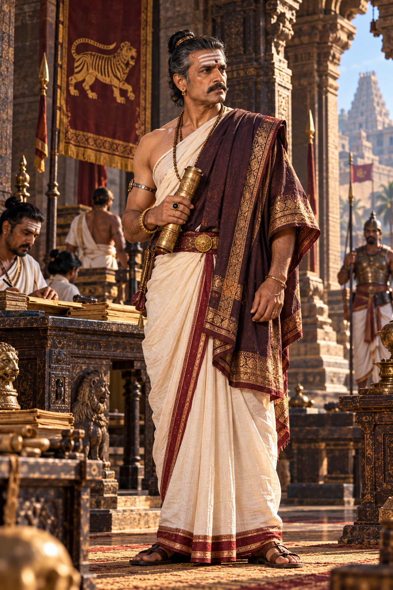

# Character Visual Dossier: The Antagonist (Senior Imperial Administrator)

- **Character ID:** CH-08 · **Canonical Tier:** Tier B (Fictional built on documented state overreach tensions)
- **Role:** High Minister / Overseer of Revenue & Logistics (The Ideological Counter-weight)
- **Evidence Tag:** `[FICTIONAL DRAMATIZATION]` (Not villain-coded; represents administrative anxiety over imperial overextension per Doc 06 §8)

---

## 1. Physical Anatomy & Silhouette
- **Age:** 48–52 years old.
- **Height / Build:** 179 cm (5'10"), upright, rigid, aristocratic posture. Lean, ascetic frame with controlled, economical gestures. Never flustered; exudes cold institutional authority.
- **Skin Tone:** Pale copper-brown, clean and immaculate.
- **Facial Features:** Narrow, high-bridged nose; thin, disciplined lips; deep-set, calculating dark eyes that miss nothing. Imposing, aristocratic brow.
- **Hair & Beard:** Meticulously oiled jet-black hair with distinguished streaks of silver at the temples, bound into a severe, tight royal administrator's bun. Clean-shaven cheeks with a sharp, minimalist mustache.
- **Forehead Markings:** Precise, immaculate three lines of white ash (*Vibhuti*) with a tiny black sandal paste dot at the center.

---

## 2. Costume & Bureaucratic Regalia (Austere Power)
- **Lower Garment (Veshti):** Spotless, starch-crisp white hand-spun silk *Veshti* draped with geometric precision, edged with a severe, narrow dark maroon border.
- **Upper Garment (Uttariya):** Formal dark charcoal-grey or deep plum silk stole draped across the left shoulder, folded in rigid pleats.
- **Waist Sash:** Dark leather belt lined with bronze fittings, carrying a bronze imperial seal container (*Mudhirai*).
- **Jewelry (Understated Restraint):**
  - Thin solid silver armlet on the upper right arm.
  - Carved black tourmaline and gold signet ring used to stamp official wax seals.
  - Narrow gold hoop earrings (*Kundalas*) without hanging pendants.

---

## 3. Demeanor & Body Language
- Controlled stillness: speaks softly without raising his voice; hands rest calmly or hold an imperial revenue ledger; physical restraint serves as a visual marker of calculating intellect.

---

## 4. Visual Prompt Reference (For Image Generation / Concept Art)
> **Midjourney / Stable Diffusion Prompt Reference:**
> *"Full body portrait of a high-ranking 50-year-old Chola Imperial Administrator, aristocratic austere South Indian statesman, sharp calculating dark eyes, severe controlled expression, silver-streaked black hair in neat bun, immaculately groomed thin mustache, clean white vibhuti ash lines on brow. Draped in crisp immaculate white silk dhoti with dark maroon border, pleated dark plum silk stole over left shoulder, silver armlet, holding an engraved bronze imperial seal cylinder. Standing in the cool stone pavilion of an imperial administrative palace, deep shadows and striking directional side-lighting, elegant and menacingly dignified. Historical realism, AAA concept art."*
