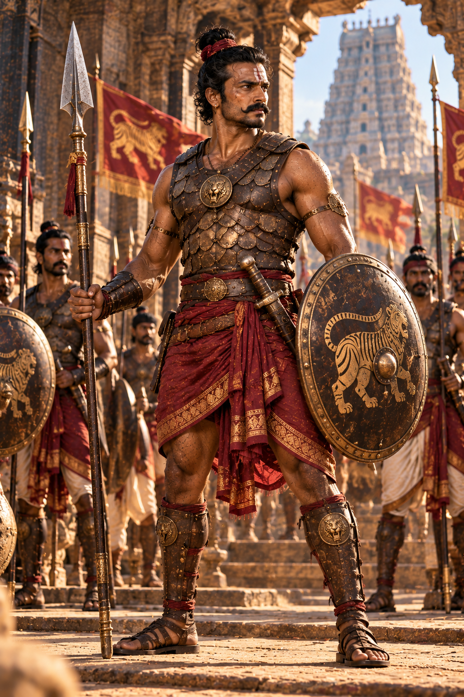

# Character Visual Dossier: Imperial Ambush Soldier / Palace Guard (Velaikkarar / Maravar)

- **Character ID:** CH-11 · **Canonical Tier:** Tier B (Military Archetype)
- **Role:** Elite Chola Foot Soldier & Ambush Combatant
- **Evidence Tag:** `[PLAUSIBLE RECONSTRUCTION]` (Built on documented Chola *Velaikkarar* and infantry units per Doc 03 I1, Doc 10)

---

## 1. Physical Anatomy & Silhouette
- **Age:** 26–32 years old.
- **Height / Build:** 178 cm (5'10"), heavily muscled, intimidating combat build; thick neck, broad shoulders, powerful arms and chest.
- **Skin Tone:** Dark, sun-weathered bronze with visible sparring and campaign scars across shoulders and arms.
- **Facial Features:** Fierce, disciplined expression; dark piercing eyes; strong jaw, thick black mustache curving downward.
- **Hair:** Coarse black hair tied into a tight warrior's topknot (*Kudumi*) on the crown, wrapped with red cotton cord.

---

## 2. Armor & Combat Attire
- **Armor (Kavacham):** Hardened multi-layered water-buffalo leather cuirass with overlapping bronze plate scales guarding the chest and abdomen.
- **Lower Garment:** Short crimson/maroon combat wrap tucked tight above the knees, secured with a broad studded leather sword belt.
- **Arm & Leg Guards:** Hardened leather bracers on forearms; greaves on shins bound with rawhide cords.
- **Footwear:** Tough leather combat sandals with reinforced soles.

---

## 3. Weapons & Shield
- **Primary Weapon:** Chola broad-bladed steel spear (*Vel*) with a polished leaf-shaped tip and brass collar, or a heavy double-edged broadsword (*Pattisa*).
- **Secondary Weapon:** Curved iron waist-dagger (*Churika*) tucked into the front belt.
- **Shield:** Circular hardened rhinoceros-hide or bronze-bossed wooden shield (*Parikkai*) painted with the Chola Tiger crest.

---

## 4. Visual Prompt Reference (For Image Generation / Concept Art)
> **Midjourney / Stable Diffusion Prompt Reference:**
> *"Full body action portrait of an elite 11th-century Chola Empire infantry warrior soldier, muscular powerful 28-year-old Tamil guard, fierce disciplined glare, dark bronze skin with battle scars, thick black mustache, hair in warrior topknot wrapped in red cord. Wearing hardened studded leather scale armor over bare muscular shoulders, crimson fighting wrap dhoti, leather bracers, holding a sharp steel leaf-bladed spear and circular bronze-rimmed tiger-crest shield, sword at waist belt. Standing in a stone gateway arch of Gangaikondacholapuram under harsh atmospheric sunlight with dust motes. Gritty AAA historical combat concept art, Unreal Engine 5."*
